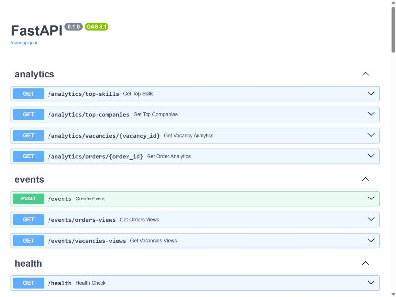
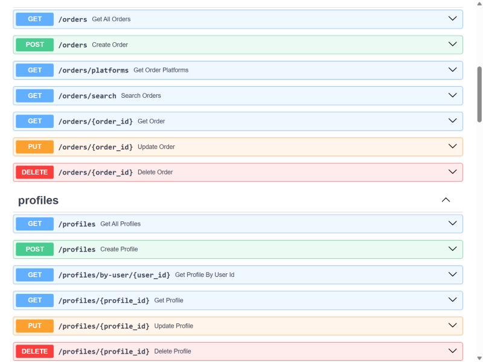
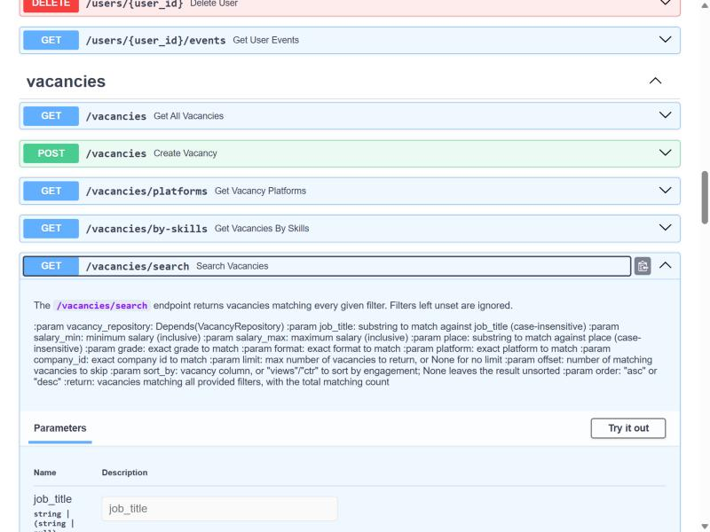
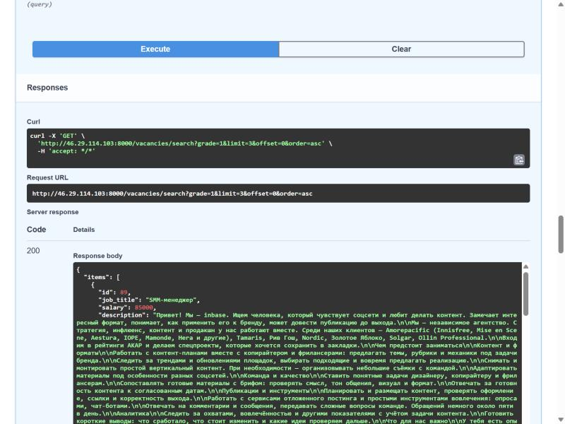

# Find Job API

Бэкенд для агрегатора вакансий и заказов с разных площадок (hh, habr, kwork, fl и других). Собирает данные в единую БД и отдаёт их наружу через REST API: с фильтрами, сортировкой, пагинацией и базовой аналитикой по вовлечённости.

Проект писался с нуля как асинхронный сервис на FastAPI и SQLAlchemy, с прицелом на то, чтобы его было легко расширять: репозитории переиспользуют общие хелперы (пагинация, подсчёт, сортировка), а не копируют одну и ту же логику в каждом файле.

## Скриншоты

Автодокументация Swagger, которую FastAPI генерирует сама по OpenAPI-схеме.

**Общий вид разделов API**


**Заказы и профили**


**Поиск вакансий с полным описанием фильтров**


**Реальный запрос и ответ сервера**


## Что умеет API

- Полный CRUD по вакансиям, заказам, профилям, навыкам и пользователям.
- Поиск с фильтрами: по названию, зарплате/цене, формату, грейду, площадке, компании и так далее. Фильтры необязательные, можно комбинировать любые.
- Пагинация с общим количеством найденного (`total`, `limit`, `offset`), а не просто голый список.
- Сортировка по колонкам и по вовлечённости: можно отсортировать вакансии по количеству просмотров или по CTR, не только по зарплате.
- Записи без значения (например, вакансии без зарплаты) корректно исключаются из выдачи при сортировке по этому полю, а не вылезают вперёд как "самые дешёвые".
- Привязка навыков к профилю (добавить/убрать), с учётом повторных вызовов без ошибок.
- История активности пользователя: какие события он совершал (просмотры, клики, поиск) и когда.
- Список площадок отдельно для вакансий и отдельно для заказов.
- Аналитика: топ навыков, топ компаний по количеству вакансий, вовлечённость по конкретной вакансии или заказу (просмотры, клики, CTR).
- `/health` с реальной проверкой соединения с базой, а не просто "сервис жив".

## Технологии

| Слой | Что используется |
|---|---|
| Язык | Python 3.12 |
| API | FastAPI 0.141, Pydantic v2 |
| База данных | PostgreSQL, SQLAlchemy 2.0 (async, asyncpg) |
| Миграции | Alembic |
| Контейнеризация | Docker, Docker Compose |
| CI/CD | GitHub Actions (деплой на пуш в ветку `dev`) |

## Архитектура

Три слоя, у каждого своя ответственность:

```
routers/        HTTP-слой: принимает запрос, валидирует входные параметры, вызывает репозиторий
repositories/    доступ к данным: строит SQL-запросы через SQLAlchemy, ничего не знает про HTTP
schemas/         Pydantic-схемы: что приходит в запросе и что уходит в ответе
db/models/       ORM-модели таблиц
```

Общая логика (пагинация, сортировка, подсчёт количества) вынесена в `BaseRepository`, а не продублирована в каждом репозитории. Конкретные репозитории (`VacancyRepository`, `OrderRepository` и остальные) достраивают поверх неё только то, что специфично для своей таблицы.

## API

Полная интерактивная документация доступна на `/docs` (Swagger UI) и `/redoc` после запуска.

| Ресурс | Эндпоинты |
|---|---|
| Вакансии | `GET /vacancies`, `GET /vacancies/search`, `GET /vacancies/by-skills`, `GET /vacancies/platforms`, `GET /vacancies/{id}`, `POST /vacancies`, `PUT /vacancies/{id}`, `DELETE /vacancies/{id}` |
| Заказы | `GET /orders`, `GET /orders/search`, `GET /orders/platforms`, `GET /orders/{id}`, `POST /orders`, `PUT /orders/{id}`, `DELETE /orders/{id}` |
| Профили | `GET /profiles`, `GET /profiles/by-user/{user_id}`, `GET /profiles/{id}`, `POST /profiles`, `PUT /profiles/{id}`, `POST /profiles/{id}/skills/{skill_id}`, `DELETE /profiles/{id}/skills/{skill_id}`, `DELETE /profiles/{id}` |
| Пользователи | `GET /users`, `GET /users/{id}`, `GET /users/{id}/events`, `POST /users`, `PUT /users/{id}`, `DELETE /users/{id}` |
| Навыки | `GET /skills`, `GET /skills/{id}`, `POST /skills`, `PUT /skills/{id}`, `DELETE /skills/{id}` |
| События | `POST /events`, `GET /events/orders-views`, `GET /events/vacancies-views` |
| Аналитика | `GET /analytics/top-skills`, `GET /analytics/top-companies`, `GET /analytics/vacancies/{id}`, `GET /analytics/orders/{id}` |
| Статус | `GET /health` |

## Запуск

### Через Docker (проще всего)

```bash
git clone https://github.com/LastCoolFish/find_job_API
cd find_job_API
cp .env.example .env   # и заполнить своими данными БД
docker compose up -d --build
```

API поднимется на `http://localhost:8000`, документация на `http://localhost:8000/docs`.

### Локально, без Docker

```bash
python -m venv .venv
.venv/Scripts/activate      # на Windows, на Linux/macOS: source .venv/bin/activate
pip install -r requirements.txt
cp .env.example .env
alembic upgrade head
uvicorn main:app --reload
```

## CI/CD

При пуше в ветку `dev` GitHub Actions сам заходит на тестовый сервер по SSH и разворачивает свежую версию: подтягивает код и пересобирает контейнер через `docker compose up -d --build`. Файл workflow лежит в `.github/workflows/deploy-dev.yml`.

## Структура проекта

```
find_job_API/
├── alembic/              миграции базы данных
├── db/
│   └── models/           ORM-модели (SQLAlchemy)
├── repositories/         доступ к данным
├── routers/              HTTP-эндпоинты
├── schemas/              Pydantic-схемы запросов и ответов
├── docker-compose.yml
├── Dockerfile
└── main.py                точка входа FastAPI
```

## Что дальше

Часть задуманного уже есть (модели `User`, `Profile`, `Event` изначально закладывались под это), часть ещё в работе:

- Рекомендации вакансий под профиль, на основе навыков и желаемой зарплаты/формата.
- Похожие вакансии по пересечению навыков.
- Валидация бизнес-правил на уровне Pydantic (например, допустимый диапазон грейда), а не только на уровне базы данных.
- Понятные коды ответов при нарушении уникальности (409 вместо голого 500).
